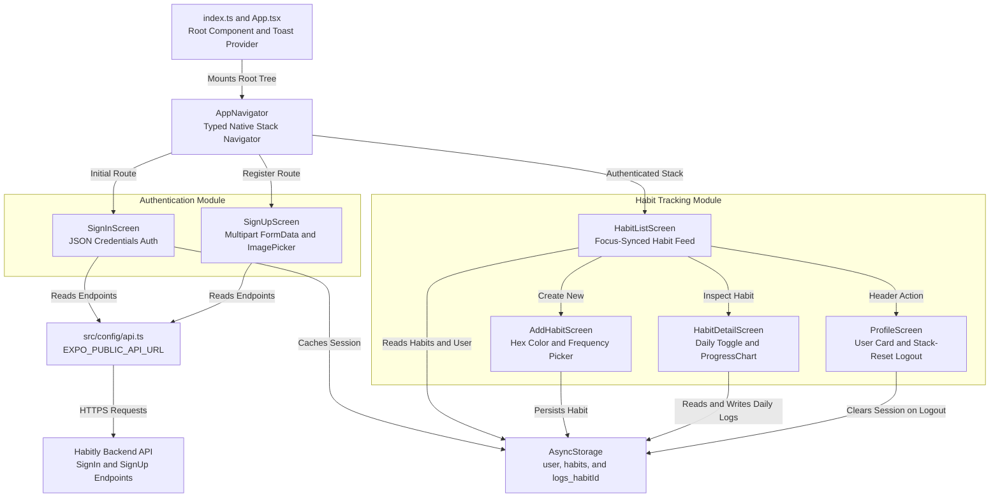
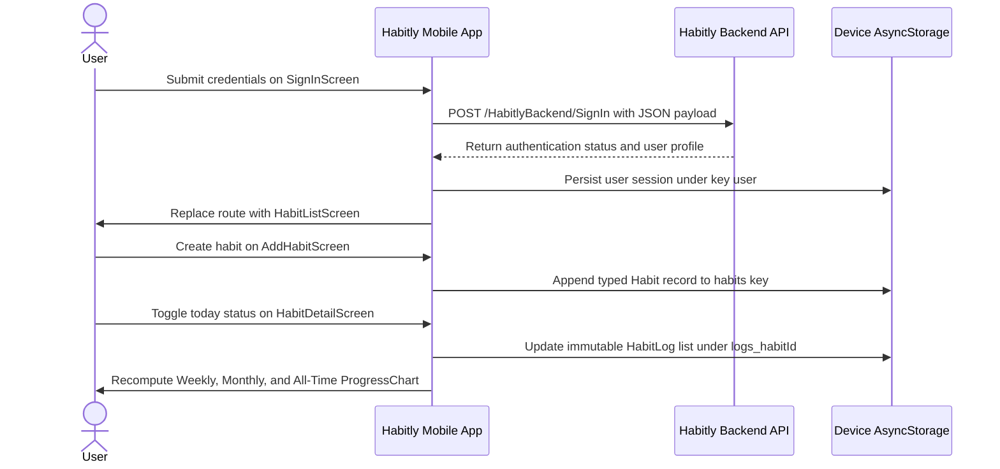

<div align="center">

# Habitly

**Cross-platform habit tracking mobile application built with Expo, React Native, and strict TypeScript.**  
Combines REST-backed user onboarding with offline-first local habit persistence and interactive completion analytics.

[](https://expo.dev/)
[](https://reactnative.dev/)
[](https://www.typescriptlang.org/)
[](https://reactnavigation.org/)
[](./LICENSE)

</div>

---

## System Architecture

Habitly uses a hybrid client architecture: user authentication and multipart avatar registration communicate with a configurable REST backend via `EXPO_PUBLIC_API_URL`, while daily habits and completion logs persist locally on-device through `AsyncStorage` for instant responsiveness.



### Authentication & Habit Completion Flow



---

## Key Engineering Highlights

- **Strict End-to-End TypeScript Navigation:** Centralized `RootStackParamList` and domain models (`Habit`, `HabitLog`, `UserProfile`, `HabitFrequency`) enforce compile-time parameter safety across all six screens with zero `any` types.
- **Externalized Environment Configuration:** Backend base URLs resolve from `EXPO_PUBLIC_API_URL` via `src/config/api.ts` rather than hardcoded tunnel URLs, supporting local, staging, and production deployments cleanly.
- **Offline-First Habit Persistence:** Habits (`habits`) and per-habit completion histories (`logs_<habitId>`) are stored locally via `@react-native-async-storage/async-storage` with focus-synchronized reloads and immutable log updates.
- **Visual Progress Analytics:** `HabitDetailScreen` computes rolling 7-day (`WEEKLY`), 30-day (`MONTHLY`), and cumulative (`ALL`) completion rates rendered with `react-native-chart-kit` and `react-native-svg`.
- **Safe Session Lifecycle:** Logout clears persisted user state and resets the native navigation stack (`navigation.reset`) to prevent back-navigation into authenticated views.
- **Multipart Profile Onboarding:** `SignUpScreen` integrates `expo-image-picker` with native `FormData` uploads, client-side validation, and submission locking.

---

## Repository Structure

```text
.
├── App.tsx                             # Root Toast provider, StatusBar, and Navigator mount
├── index.ts                            # Expo root component registration
├── app.json                            # Expo SDK 53 app configuration (iOS, Android, Web)
├── package.json                        # Dependencies and npm scripts
├── tsconfig.json                       # Strict TypeScript configuration
├── .env.example                        # Environment variable template
├── LICENSE                             # MIT License
├── assets/                             # App icons, splash artwork, and default avatar
└── src/
    ├── config/
    │   └── api.ts                      # Environment-driven REST API endpoint definitions
    ├── types/
    │   └── habit.ts                    # Shared Habit, HabitLog, and UserProfile interfaces
    ├── navigation/
    │   └── AppNavigator.tsx            # Typed React Navigation native stack
    └── screens/
        ├── Auth/
        │   ├── SignInScreen.tsx        # User sign-in with toast feedback and error handling
        │   └── SignUpScreen.tsx        # Registration with avatar picker and FormData upload
        ├── Home/
        │   ├── HabitListScreen.tsx     # Focus-synced list of user habits
        │   ├── AddHabitScreen.tsx      # Habit creation with validated hex color & frequency
        │   └── HabitDetailScreen.tsx   # Daily check-in toggle, ProgressChart, and log history
        └── Profile/
            └── ProfileScreen.tsx       # User profile overview and stack-resetting logout
```

---

## Getting Started

### Prerequisites

- **Node.js** 20+ and **npm** 10+
- **Expo Go** on iOS/Android, or an iOS Simulator / Android Emulator
- A running Habitly backend service exposing `POST /HabitlyBackend/SignIn` and `POST /HabitlyBackend/SignUp`

### 1. Clone & Install

```bash
git clone https://github.com/theekshana-sudeepa/HHDP_1.git
cd HHDP_1
npm install
```

### 2. Configure Environment Variables

```bash
cp .env.example .env
```

Edit `.env` to point to your backend host:

```env
EXPO_PUBLIC_API_URL=http://localhost:8080
```

> **Note:** On a physical device using Expo Go, use your machine's LAN IP (e.g., `http://192.168.1.10:8080`) or an HTTPS tunnel URL instead of `localhost`.

### 3. Typecheck & Run

```bash
# Verify strict TypeScript compilation
npm run typecheck

# Start the Expo development server
npm start

# Platform shortcuts
npm run android
npm run ios
npm run web
```

---

## License

This project is licensed under the **MIT License** — see the [LICENSE](./LICENSE) file for details.

---

<div align="center">

Built by **Theekshana Sudeepa**  
[LinkedIn](https://www.linkedin.com/in/theekshana-sudeepa/) · [GitHub](https://github.com/theekshana-sudeepa) · [LexoraTech](https://lexoratech.com)

</div>
